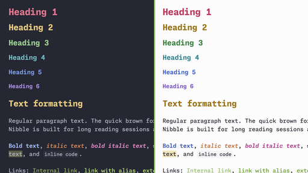

# Nibble

A calm, colorful dark theme for [Obsidian](https://obsidian.md), built around monospace typography.

Nibble is a personal theme. I made it for my own everyday use, so it reflects my taste and the way I work. If it suits you too, I'd be really happy for you to use it! Feedback and ideas are always welcome.

## Fonts

Nibble is designed for **Monaspace Neon NF** and **JetBrains Mono**. The whole interface, your notes and code blocks all use these fonts.

The theme does not bundle fonts, so install at least one of them before using Nibble:

- [Monaspace](https://github.com/githubnext/monaspace) — primary font. Install the **Neon NF** variant.
- [JetBrains Mono](https://www.jetbrains.com/lp/mono/) — fallback if Monaspace Neon NF is not installed.

If neither font is installed, Obsidian falls back to your system monospace font, and the theme will not look as intended.

Prefer a different font? You can override it in **Settings → Appearance → Font**.

## Features

- Dark mode only
- Colored headings, from H1 to H6, each in its own color
- Distinct colors for **bold**, *italic* and ***bold italic*** text
- Buttons, inputs, borders and hover states tinted to match the background
- Works with Obsidian's accent color: change it in **Settings → Appearance → Accent color**

## Installation

### From Community themes

1. Open **Settings → Appearance → Themes → Manage**.
2. Search for **Nibble**.
3. Select **Install and use**.

### Manually

1. Download `manifest.json` and `theme.css` from the [latest release](https://github.com/n3xtb1te/Nibble/releases/latest).
2. Create a folder named `Nibble` in `<your vault>/.obsidian/themes/`.
3. Put both files in that folder.
4. Open **Settings → Appearance → Themes** and select **Nibble**.

## Support

If you enjoy Nibble, you can [buy me a coffee](https://buymeacoffee.com/n3xtb1te).

## License

[MIT](LICENSE) © n3xtb1te
